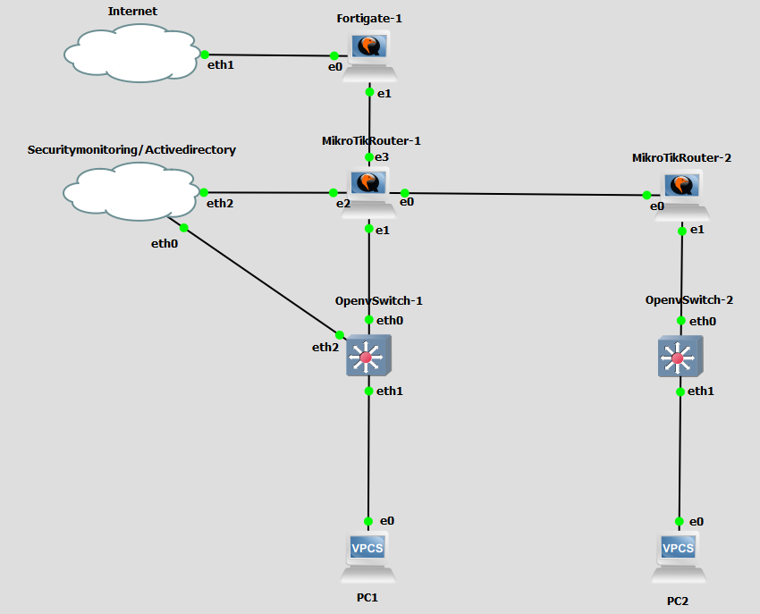
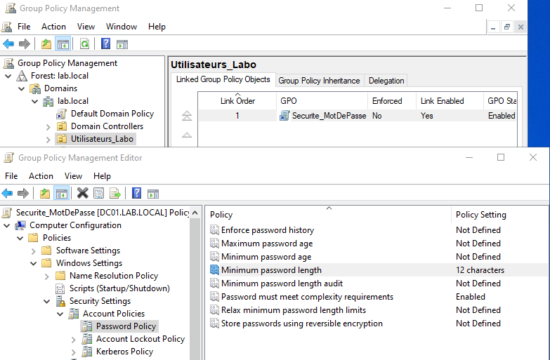
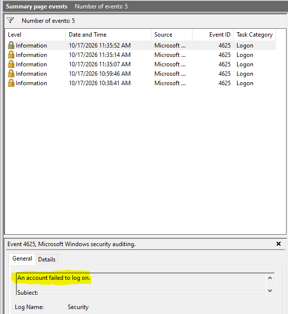
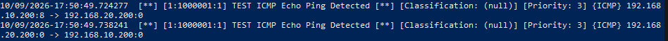
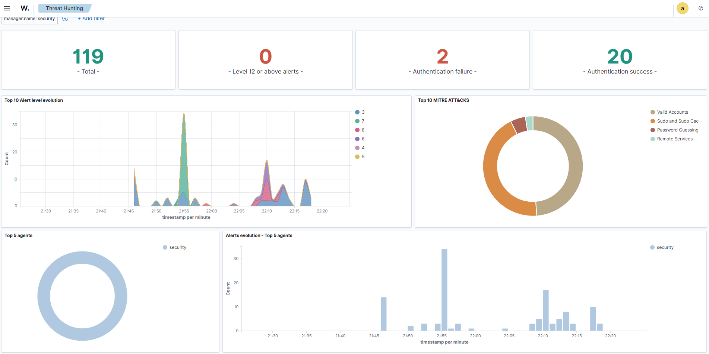
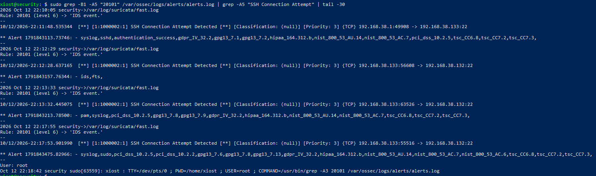

# Enterprise System & Security Home Lab
### Focus: Windows Server, Active Directory & SOC Monitoring

## Project Overview
This project is a virtualized enterprise infrastructure designed to simulate a real-world corporate Windows environment. The main goal was to design a secure network, deploy a complete Windows Server Domain, and implement a SOC (Security Operations Center) monitoring pipeline (Suricata, Zeek, Wazuh) to audit and protect the infrastructure.

## Architecture & Topology

- **Systems Layer (Core Focus):** Windows Server 2022 (Active Directory Domain Services, DNS, DHCP, GPO, Advanced Auditing). The server is hosted on VMware and connected to the `SecurityMonitoring` cloud network.
- **Network Layer:** MikroTik Routers with OSPF dynamic routing, VLAN segmentation, and Open vSwitch (OVS) for Layer 2 switching.
- **Security Edge:** FortiGate Firewall (NAT, Firewall Policies).
- **Monitoring & SOC:** Wazuh (SIEM), Suricata (IDS), and Zeek (Network Metadata) fed by mirrored traffic to monitor AD security events.

## Key Implementations

### 1. Windows Server & Active Directory (Main Focus)

- Promoted a Windows Server 2022 to a Domain Controller (Forest: `lab.local`).
- Structured the directory with Organizational Units (OUs), Users, and Security Groups.
- Applied Group Policy Objects (GPO) to enforce password complexity (12 characters minimum).
- Enabled Advanced Audit Policy to generate **Event ID 4625** (Failed Logons) for brute-force detection.

### 2. Network Segmentation & Security
- Configured VLANs to isolate traffic (Management, Users, Servers).
- Deployed OSPF to allow dynamic routing between routers.
- Deployed a FortiGate firewall at the edge with NAT and filtering policies.
- **Validated inter-VLAN routing** with successful ICMP traffic between PC1 (VLAN 10) and PC2 (VLAN 20).

### 3. SOC & Threat Detection

- Set up Open vSwitch (OVS) with port mirroring (SPAN) to send a copy of the network traffic to the monitoring interface.
- Deployed **Zeek** for network metadata analysis (DNS, HTTP, TLS) and **Suricata** for signature-based intrusion detection.
- Centralized Windows Event Logs and network logs in **Wazuh SIEM**.
- Wrote custom detection rules for suspicious activities (e.g., brute force, Nmap scans) and mapped them to MITRE ATT&CK.

## Tech Stack
- **Systems:** Windows Server 2022, Active Directory, DNS, GPO, Ubuntu Server
- **Networking:** MikroTik, Open vSwitch, OSPF, VLAN, TCP/IP
- **Security:** FortiGate, Wazuh, Suricata, Zeek
- **Virtualization:** VMware, GNS3
